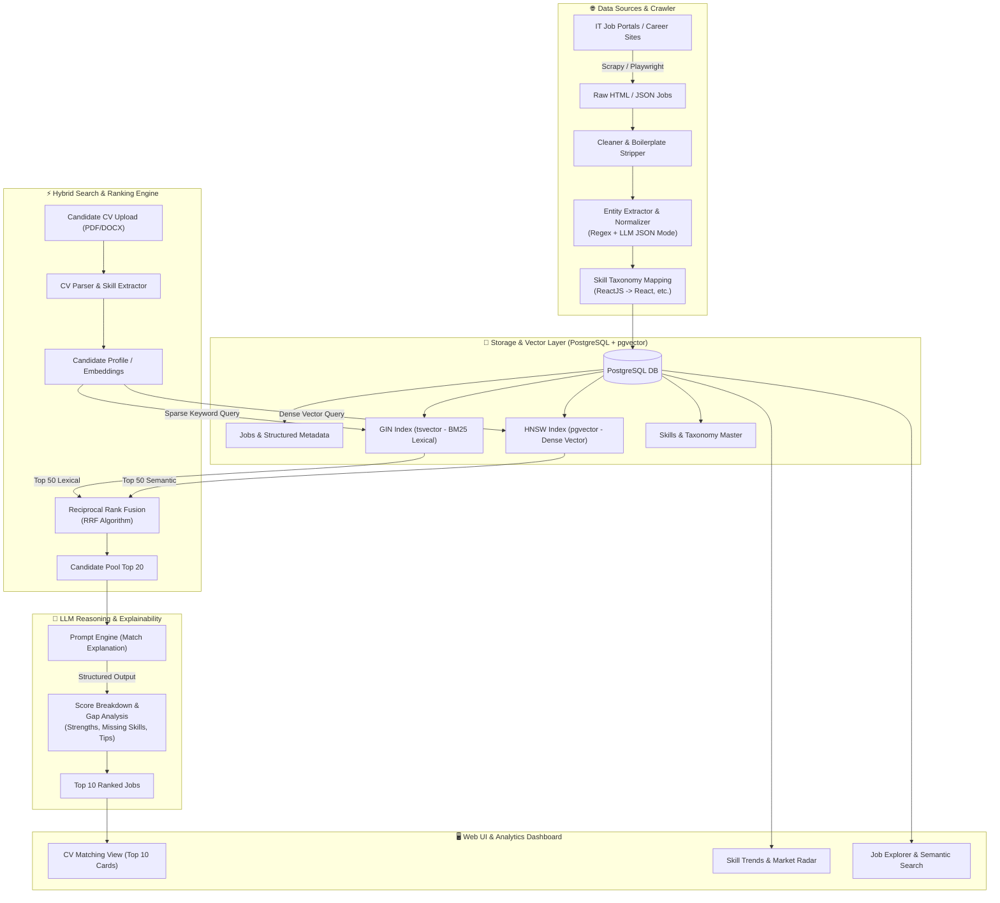

# AI-Powered Job Matching & Semantic Search System (CV ↔ JD)

Hệ thống gợi ý việc làm thông minh dựa trên kỹ thuật **Hybrid Search (Dense Vector + Sparse Keyword)** và **LLM Explainability**, kết hợp Data Engineering Pipeline thu thập, làm sạch và chuẩn hóa dữ liệu tuyển dụng IT.

---

## 🏗️ 1. Kiến Trúc Tổng Thể (System Architecture)



---

## 🧩 2. Các Thành Phần Cốt Lõi (Core Components)

### 2.1. Data Engineering Pipeline (`/pipelines`)
* **Crawler:** Thu thập tin tuyển dụng từ các nguồn công khai, tuân thủ `robots.txt`.
* **Cleaner:** Lọc bỏ nội dung quảng cáo, phúc lợi chung chung, chỉ giữ lại phần **Job Title**, **Requirements**, **Tech Stack**, và **Level**.
* **Skill Normalizer:** Sử dụng từ điển kỹ năng chuẩn (`skills_taxonomy.json`) kết hợp trích xuất thực thể để đồng nhất hóa (ví dụ: `React.js`, `ReactJS` $\to$ `React`; `AWS Cloud` $\to$ `AWS`).

### 2.2. Storage & Vector Database (`PostgreSQL + pgvector`)
* **Kiến trúc "All-in-One":** Không cần triển khai riêng Milvus hay ElasticSearch.
* **Lexical Search:** Cột `search_vector` (`tsvector`) kết hợp `to_tsquery` để bắt chính xác các keyword bắt buộc (Java, Go, Kubernetes).
* **Dense Semantic Search:** Cột `embedding` (`vector(1536)` hoặc `vector(384)`) sử dụng thuật toán index **HNSW** cho tốc độ tìm kiếm siêu nhanh dưới 10ms.

### 2.3. Hybrid Search & RRF (`backend/app/services/hybrid_search.py`)
* Thuật toán **Reciprocal Rank Fusion (RRF)**:
  $$RRF\_Score(d) = \sum_{m \in M} \frac{1}{k + rank_m(d)}$$
  *(với $k = 60$, kết hợp thứ hạng từ Keyword Search và Dense Cosine Distance)*
* Giải quyết triệt để vấn đề:
  * Semantic Search hiểu được ngữ cảnh nhưng hay bỏ sót các từ khóa công nghệ chính xác.
  * Keyword Search tìm đúng từ khóa nhưng không hiểu được kinh nghiệm tương đương (VD: "GCP" tương đương "Cloud Platform").

### 2.4. Prompt Engineering & Reasoning (`backend/app/services/explainer.py`)
* Không chỉ trả về điểm số phần trăm đơn thuần. LLM phân tích theo 4 chiều:
  1. **Match Score (%):** Độ tương thích tổng thể.
  2. **Matched Strengths:** Những điểm mạnh ứng viên đáp ứng đúng yêu cầu tuyển dụng.
  3. **Skill Gaps:** Những công nghệ còn thiếu theo yêu cầu của JD.
  4. **Actionable Roadmap:** Lộ trình ngắn gọn để ứng viên tự học bổ sung trước khi nộp đơn.

---

## 🚀 3. Hướng Dẫn Khởi Chạy Nhanh (Quick Start)

### Yêu cầu tiên quyết
* Đã cài đặt Docker & Docker Compose.
* Tạo file cấu hình môi trường từ mẫu:
  ```bash
  cp .env.example .env
  ```

### Khởi chạy toàn bộ hệ thống
```bash
docker compose up -d --build
```

* **Backend API Documentation:** `http://localhost:8000/docs`
* **Frontend Web Dashboard:** `http://localhost:3000`
* **PostgreSQL pgvector:** `localhost:5432` (user: `postgres`, db: `jobmatch_db`)
