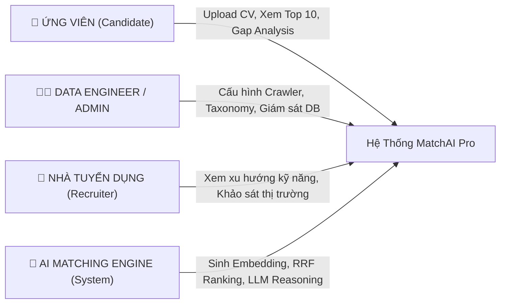

# 🎯 FEATURES_AND_USE_CASES.MD: TÍNH NĂNG, USE CASE & VAI TRÒ HỆ THỐNG

> **Dự án:** MatchAI Pro - Hệ thống gợi ý việc làm bằng Semantic Search & LLM Explainability  
> **Phân loại:** Hybrid (Data Engineering + AI Engineering)

---

## 👥 1. CÁC VAI TRÒ TRONG HỆ THỐNG (SYSTEM ACTORS / ROLES)

### 1. Ứng Viên (Candidate) - *Người dùng chính*
* Là người tìm kiếm cơ hội nghề nghiệp phù hợp với năng lực hiện có.
* Tải lên CV (dạng file PDF, Word hoặc văn bản) để nhận ngay Top 10 công việc sát nhất.
* Đọc giải thích từ AI: vì sao mình phù hợp, mình còn thiếu kỹ năng gì, và cần học gì để đậu phỏng vấn.

### 2. Kỹ Sư Dữ Liệu / Quản Trị Viên (Data Engineer / Admin)
* Chịu trách nhiệm thiết lập và giám sát các luồng cào dữ liệu (Crawlers).
* Quản lý bộ từ điển kỹ năng (`skills_taxonomy.json`), mapping các biến thể kỹ năng mới xuất hiện trên thị trường.
* Giám sát tài nguyên PostgreSQL + pgvector và tỷ lệ vector hóa của các tin tuyển dụng.

### 3. Nhà Tuyển Dụng / Chuyên Gia Hướng Nghiệp (Recruiter / Career Advisor)
* Theo dõi **Radar xu hướng kỹ năng hot (Market Tech Radar)** để nắm bắt nhu cầu công nghệ đang tăng trưởng.
* Tra cứu cơ sở dữ liệu JD để đối sánh mức lương, yêu cầu cấp bậc theo từng công nghệ.

### 4. Hệ Thống Trí Tuệ Nhân Tạo (AI Matching Engine) - *Actor Tự Động*
* Chạy nền thực hiện các tác vụ nặng:
  * Trích xuất thực thể (NER - Named Entity Recognition) từ JD và CV.
  * Vector hóa nội dung sang không gian 1536 chiều bằng `pgvector`.
  * Xếp hạng danh sách ứng viên qua thuật toán **Reciprocal Rank Fusion (RRF)**.
  * Gọi mô hình LLM để sinh phân tích lý do phù hợp theo định dạng JSON có cấu trúc.

---

## 🚀 2. MA TRẬN TÍNH NĂNG (FEATURE MATRIX)

| Mã | Tên Tính Năng | Mô Tả Nghiệp Vụ | Phụ Trách Kỹ Thuật |
| :---: | :--- | :--- | :--- |
| **F-01** | **Data Ingestion & Cleaning** | Thu thập tự động tin tuyển dụng từ web công khai, lọc sạch thẻ HTML và rác quảng cáo, trích xuất riêng phần yêu cầu chuyên môn. | Scrapy / BeautifulSoup / Data Cleaner |
| **F-02** | **Skill Entity Normalization** | Nhận diện và ánh xạ các từ đồng nghĩa/viết tắt (`ReactJS` -> `React`, `k8s` -> `Kubernetes`) theo từ điển taxonomy chuẩn. | Regex + Pydantic JSON Mode |
| **F-03** | **CV Parsing Engine** | Đọc nội dung CV từ file `.pdf`, `.docx` hoặc text thô; trích xuất số năm kinh nghiệm, kỹ năng và tóm tắt hồ sơ. | `pypdf`, `python-docx` |
| **F-04** | **Hybrid Search & RRF Ranking** | Kết hợp tìm kiếm từ khóa chính xác (PostgreSQL Full-Text Search `tsvector`) và tìm kiếm ngữ nghĩa sâu (pgvector Cosine Distance) qua thuật toán RRF. | PostgreSQL 16 + pgvector + RRF |
| **F-05** | **AI Explainability & Gap Analysis** | Phân tích chi tiết độ tương thích: Match Score (%), Điểm mạnh khớp JD, Lỗ hổng kỹ năng cần bổ sung, và Lời khuyên chuẩn bị phỏng vấn. | Prompt Engineering (GPT-4o-mini / Dual Mock) |
| **F-06** | **Market Skill Radar & Trends** | Bảng điều khiển phân tích tần suất xuất hiện của các công nghệ theo nhóm ngành (DevOps, Data/AI, Backend, Frontend, Database). | FastAPI Analytics API + React Dashboard |
| **F-07** | **Multi-faceted Job Explorer** | Tra cứu việc làm bằng ngôn ngữ tự nhiên, kết hợp lọc theo cấp bậc (Junior/Mid/Senior) và địa điểm làm việc. | Hybrid Search Query + React Filter |

---

## 📖 3. CÁC USE CASE CHI TIẾT (USE CASE SPECIFICATIONS)

### 📌 USE CASE UC-01: So Khớp CV Ứng Viên Với Toàn Bộ Job Database
* **Actor chính:** Ứng viên (Candidate).
* **Tiền điều kiện (Pre-conditions):** Hệ thống đã có dữ liệu việc làm trong PostgreSQL và vector embedding đã được tính toán.
* **Luồng sự kiện chính (Main Flow):**
  1. Ứng viên truy cập vào Tab **"CV Matcher & AI Advisor"**.
  2. Ứng viên dán nội dung CV hoặc bấm nút **"⚡ Quick Load Candidate"** để chọn hồ sơ mẫu (DevOps, Data/AI, Fullstack).
  3. Ứng viên bấm nút **"Match CV with pgvector & AI"**.
  4. Hệ thống backend:
     - Bóc tách văn bản, trích xuất danh sách kỹ năng chuẩn hóa (`cv_parser.py`).
     - Sinh vector đại diện cho CV (`embedding.py`).
     - Thực thi truy vấn Hybrid Search (Dense Cosine + Sparse BM25) qua thuật toán RRF trên PostgreSQL để lấy Top 20 ứng viên tiềm năng (`hybrid_search.py`).
     - Chạy mô hình LLM Reasoning để sinh điểm số, điểm mạnh, điểm thiếu cho Top 10 (`explainer.py`).
  5. Giao diện hiển thị:
     - Thẻ tóm tắt thông tin ứng viên (Số năm kinh nghiệm, các kỹ năng được hệ thống nhận diện).
     - Danh sách Top 10 vị trí phù hợp nhất, kèm điểm phần trăm độ khớp (Color-coded: Xanh lá $\ge 80\%$, Xanh lam $\ge 65\%$).
* **Hậu điều kiện (Post-conditions):** Kết quả được hiển thị tức thời, không lưu trữ dữ liệu cá nhân nhạy cảm lên ổ đĩa.

---

### 📌 USE CASE UC-02: Xem Phân Tích Lỗ Hổng Kỹ Năng & Lời Khuyên Hướng Nghiệp
* **Actor chính:** Ứng viên (Candidate).
* **Tiền điều kiện:** Ứng viên đã thực hiện xong UC-01 và đang xem danh sách Top 10 công việc.
* **Luồng sự kiện chính (Main Flow):**
  1. Tại một thẻ công việc mong muốn, ứng viên bấm vào nút **"AI Reasoning & Gap Analysis"**.
  2. Hệ thống mở rộng Accordion hiển thị chi tiết:
     - **Why You Match (Điểm mạnh):** Danh sách các kỹ năng của ứng viên trực tiếp đáp ứng tiêu chí bắt buộc của JD.
     - **Areas for Preparation (Lỗ hổng kỹ năng):** Các công nghệ mà JD yêu cầu nhưng chưa thấy xuất hiện rõ ràng trong CV.
     - **Career Advisor Recommendation (Lời khuyên hành động):** Lời khuyên trọng tâm giúp ứng viên ôn tập hoặc định hướng bổ sung project trước buổi phỏng vấn.
  3. Ứng viên có thể bấm đóng lại để xem các công việc khác.

---

### 📌 USE CASE UC-03: Xem Dashboard Xu Hướng Kỹ Năng IT Thị Trường
* **Actor chính:** Ứng viên, Nhà tuyển dụng, Quản trị viên.
* **Tiền điều kiện:** Hệ thống đã thu thập và chuẩn hóa dữ liệu của các tin tuyển dụng.
* **Luồng sự kiện chính (Main Flow):**
  1. Người dùng bấm chuyển sang Tab **"Market Skill Radar"**.
  2. Frontend gọi API `GET /api/v1/analytics/hot-skills`.
  3. Backend truy vấn SQL aggregation kết hợp bảng `skills` và `job_skills`.
  4. Màn hình hiển thị:
     - Biểu đồ thanh ngang (Progress Bar) xếp hạng các công nghệ được săn đón nhiều nhất (Python, Docker, Kubernetes, AWS, v.v.).
     - Thống kê tỷ trọng theo danh mục ngành nghề (DevOps & Cloud, Data & AI, Backend, Database, Frontend).

---

### 📌 USE CASE UC-04: Tra Cứu & Tìm Kiếm Việc Làm Bằng Ngôn Ngữ Tự Nhiên
* **Actor chính:** Ứng viên (Candidate).
* **Luồng sự kiện chính (Main Flow):**
  1. Người dùng bấm sang Tab **"Job Database Explorer"**.
  2. Nhập câu truy vấn tìm kiếm (ví dụ: *"Senior DevOps Kubernetes AWS"* hoặc *"Chuyên viên xử lý dữ liệu lớn với Spark"*).
  3. Có thể chọn bộ lọc cấp bậc kinh nghiệm (*Junior*, *Mid-Level*, *Senior*).
  4. Hệ thống thực thi tìm kiếm ngữ nghĩa kết hợp từ khóa, hiển thị danh sách các JD thỏa mãn kèm thẻ tag kỹ năng.

---

### 📌 USE CASE UC-05: Thu Thập & Chuẩn Hóa Tin Tuyển Dụng Mới (Admin/DE)
* **Actor chính:** Data Engineer / Hệ thống định kỳ (Pipeline Worker).
* **Luồng sự kiện chính (Main Flow):**
  1. Pipeline kích hoạt theo lịch (hoặc chạy thủ công qua lệnh Docker).
  2. Worker gọi module Crawler tải các tin tuyển dụng mới, tuân thủ `robots.txt` và `DOWNLOAD_DELAY`.
  3. Module Cleaner loại bỏ thẻ HTML, lọc phần yêu cầu kỹ thuật.
  4. Module Normalizer tra cứu từ điển `skills_taxonomy.json` để chuẩn hóa các nhãn công nghệ.
  5. Module Embedding sinh vector biểu diễn nội dung và nạp vào bảng `jobs` trong PostgreSQL.
  6. PostgreSQL tự động cập nhật `search_vector` và `HNSW Index`.

---

## ⚡ 4. YÊU CẦU PHI CHỨC NĂNG (NON-FUNCTIONAL REQUIREMENTS)

1. **Tốc độ phản hồi (Latency):**
   - Truy vấn tìm kiếm Vector và Full-Text Search trong PostgreSQL: **< 100ms** (nhờ HNSW & GIN index).
   - Toàn bộ luồng parse CV và trả về Top 10 kèm giải thích LLM: **< 3 giây**.
2. **Khả năng mở rộng (Scalability):**
   - Thiết kế chịu tải tốt với tập dữ liệu từ **1.000 đến 100.000 JD** mà không cần nâng cấp thêm cụm máy chủ phụ.
3. **Độ chính xác gợi ý (Accuracy & Quality):**
   - Chỉ số **Precision@10 $\ge 70\%$** (ít nhất 7/10 công việc được người dùng đánh giá là thực sự phù hợp).
   - Chỉ số **MRR (Mean Reciprocal Rank) $\ge 0.75$**.
4. **Tính sẵn sàng & Khả năng vận hành (DevOps Availability):**
   - 100% triển khai qua Docker Compose, cấu hình tự động khởi động lại khi gặp sự cố (`restart: always`).
   - Có cơ chế **Dual-Mode** đảm bảo hệ thống luôn demo được ngay cả khi mất kết nối mạng ngoài hoặc hết hạn ngạch API LLM.
