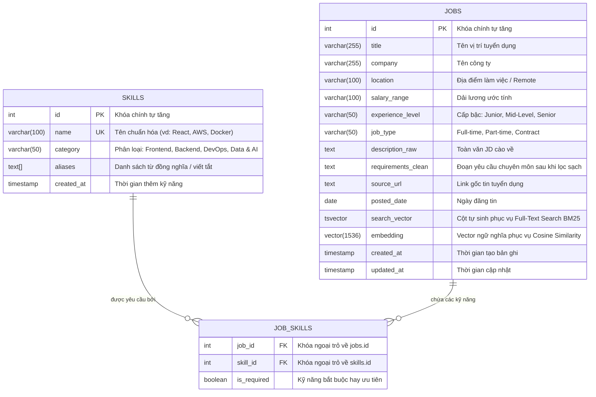

# 💾 THIẾT KẾ CƠ SỞ DỮ LIỆU & VECTOR ENGINE (DATABASE SCHEMA)

> **Hệ quản trị CSDL:** PostgreSQL 16  
> **Tiện ích mở rộng cốt lõi:** `pgvector` (Vector Search Extension)

---

## 1. SƠ ĐỒ THỰC THỂ MỐI QUAN HỆ (ERD DIAGRAM)



---

## 2. CHI TIẾT CÁC BẢNG (TABLE SPECIFICATIONS)

### 2.1. Bảng `jobs` (Tin Tuyển Dụng)
Chứa toàn bộ thông tin của tin tuyển dụng, bao gồm cả dữ liệu có cấu trúc (metadata), dữ liệu tìm kiếm từ khóa (`tsvector`), và dữ liệu vector embedding (`vector(1536)`).

* **Cột tự sinh `search_vector`:**
  ```sql
  search_vector tsvector GENERATED ALWAYS AS (
      to_tsvector('english', coalesce(title, '') || ' ' || coalesce(requirements_clean, ''))
  ) STORED;
  ```
  *Tự động tính toán lại mỗi khi `title` hoặc `requirements_clean` thay đổi.*

### 2.2. Bảng `skills` (Từ Điển Kỹ Năng Chuẩn)
Lưu trữ danh mục Taxonomy chuẩn để phục vụ Entity Resolution và thống kê Analytics.
* Cột `aliases`: Mảng chuỗi (`TEXT[]`), chứa các cách viết khác nhau (ví dụ: `['reactjs', 'react.js', 'react']`).

### 2.3. Bảng `job_skills` (Liên Kết Công Việc - Kỹ Năng)
Bảng trung gian thiết lập quan hệ Nhiều-Nhiều (Many-to-Many) giữa `jobs` và `skills`. Có thiết lập `ON DELETE CASCADE`.

---

## 3. CHIẾN LƯỢC ĐÁNH CHỈ MỤC (INDEXING STRATEGY)

Để tối ưu hóa hiệu năng truy vấn dưới 10ms, hệ thống thiết lập 4 chỉ mục chiến lược:

1. **HNSW Index trên cột `embedding`:**
   ```sql
   CREATE INDEX idx_jobs_embedding_hnsw ON jobs 
   USING hnsw (embedding vector_cosine_ops) 
   WITH (m = 16, ef_construction = 64);
   ```
   *Tối ưu cho toán tử khoảng cách Cosine `<=>`.*

2. **GIN Index trên cột `search_vector`:**
   ```sql
   CREATE INDEX idx_jobs_search_vector ON jobs USING GIN (search_vector);
   ```
   *Tối ưu cho toán tử tìm kiếm Full-Text `@@`.*

3. **B-Tree Index trên `experience_level` & `location`:**
   *Phục vụ việc lọc (filtering) kết hợp trong các câu truy vấn đa chiều.*

---

## 4. CÁC TRUY VẤN MẪU THƯỜNG DÙNG

### Truy vấn Vector Cosine Distance:
```sql
SELECT id, title, company, (embedding <=> :query_vector::vector) AS cosine_distance
FROM jobs
WHERE embedding IS NOT NULL
ORDER BY embedding <=> :query_vector::vector ASC
LIMIT 10;
```

### Truy vấn Thống Kê Kỹ Năng Hot:
```sql
SELECT s.name, s.category, COUNT(js.job_id) as demand_count
FROM skills s
JOIN job_skills js ON s.id = js.skill_id
GROUP BY s.id, s.name, s.category
ORDER BY demand_count DESC
LIMIT 15;
```
